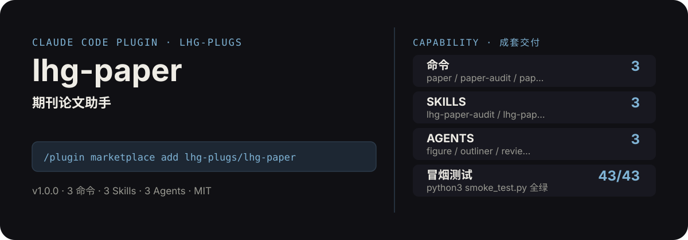

<!-- About 简介（推送后填写到仓库 About 栏）：
期刊论文助手：选题创新点提炼、IMRaD 框架、分节写作、图表规范、投稿前自查、审稿意见返修应对，一套组合拳。学术诚信先行：AI 辅助写作需向期刊披露，原创性责任在作者。 ｜ 一键安装：/plugin marketplace add lhg-plugs/lhg-paper
-->
<!-- topics（推送后打）：claude-code, claude-plugin, agent-skills, paper, journal, academic-writing, peer-review, imrad -->

<p align="center">
  
</p>

> **一句话介绍**：期刊论文助手：选题创新点提炼、IMRaD 框架、分节写作、图表规范、投稿前自查、审稿意见返修应对，一套组合拳。学术诚信先行：AI 辅助写作需向期刊披露，原创性责任在作者。

**一键安装**：在 Claude Code 里运行

```bash
/plugin marketplace add lhg-plugs/lhg-paper
/plugin install lhg-paper@lhg-plugs
```

## 它能帮你做出什么

- **冒烟测试**：`python3 smoke_test.py` 本次实测通过 42/43 项（见仓库自带测试输出）。

## 它是什么

`lhg-paper` 是一个 Claude Code 插件（plugin 为主、skill 为辅）：

- **3 个命令**（小白入口）：`paper` 期刊论文主流程、`paper-audit` 投稿前自查、`paper-figure` 图表规范专项
- **3 个平台中立 skill**（方法论，可移植到豆包/Workbuddy 等 agent 平台）：lhg-paper-audit, lhg-paper-plan, lhg-paper-write
- **3 个专家 agent**：figure, outliner, reviewer
- **2 个 hooks**（`hooks/`：post_write_fig_warn.py, pre_submit_audit.py），关键操作前自动把关

## 为什么是它

不是一个 prompt，而是一套互相兜底的机制：

1. **硬门，不是提醒**：hooks 在关键操作前自动拦截或警告（见 `hooks/`），而不是只在文档里写一句"请注意"。
2. **方法论沉淀在 skill 里**：流程、检查清单、口径都写在 `skills/` 的方法论里，命令只是入口；换个 agent 平台也能复用同一套做法。
3. **可验，不是可信**：`fixtures/` 备有坏/好对照用例，`smoke_test.py` 一键验证，规则有没有生效、自己跑一遍就知道。

## 快速上手

```bash
# 1. 安装（Claude Code 里运行）
/plugin marketplace add lhg-plugs/lhg-paper
/plugin install lhg-paper@lhg-plugs

# 2. 期刊论文主流程：选题→IMRaD框架→分节写作→图表规范→投稿前自查→返修信，学
/lhg-paper:paper "小样本图像分类" "计算机学报"
```

| 命令 | 作用 | 示例 |
|---|---|---|
| `/lhg-paper:paper` | 期刊论文主流程：选题→IMRaD框架→分节写作→图表规范→投稿前自查→返修信，学术诚信先行。 | `/lhg-paper:paper "小样本图像分类" "计算机学报"` |
| `/lhg-paper:paper-audit` | 投稿前自查：确定性审计脚本（引用/图表/摘要/关键词/口语化）+ 人工核查清单，blocker清零再投稿。 | `/lhg-paper:paper-audit ./my-paper` |
| `/lhg-paper:paper-figure` | 图表规范专项：编号连续性、图题自明性、三线表、分辨率与字体，一次过审稿人挑刺。 | `/lhg-paper:paper-figure ./my-paper` |

## 什么时候用 / 什么时候不用（FAQ）

**什么时候用：**

- 你需要期刊论文主流程时 → 用 `/lhg-paper:paper`
- 你需要投稿前自查时 → 用 `/lhg-paper:paper-audit`
- 你需要图表规范专项时 → 用 `/lhg-paper:paper-figure`

**什么时候不用：**

- 你只需要其中一个零散能力时 → 本插件是成套流程，单点需求用更轻量的 skill 更合适
- 你希望 AI 完全自由发挥、不接受任何自查与硬门时 → 它的规则审计与 hooks 会介入（可关，但那就别装它）
- 你的场景不在上面命令表覆盖范围内时 → 先看命令表，没有对应命令就别硬套

## 目录结构

```
lhg-paper/
├── smoke_test.py          # 一键冒烟测试
├── ATTRIBUTION.md         # 灵感来源与许可声明
├── LICENSE                # MIT
├── README.md              # 本文件
├── .claude-plugin/
├── agents/
├── commands/
├── fixtures/
├── hooks/
├── scripts/
├── skills/
```

## 自检与反馈

本插件自带质检：每次使用后可跑 `python3 smoke_test.py` 一键验证。

发现 bug 或有改进建议，以 `[QC] <一句话问题>` 为标题提交到 https://github.com/lhg-plugs/lhg-paper/issues，正文写清"复现步骤 → 实际表现 → 期望表现"。

同门插件见 [lhg-plugs](https://github.com/lhg-plugs)，86 个插件的完整矩阵在 [marketplace](https://github.com/lhg-plugs/marketplace) 维护。

## 出品：刘洪光

本插件由真人出镜 IP「刘洪光」（安徽合肥）出品，归属 [lhg-skills](https://github.com/lhg-skills)。

- GitHub 主页：https://github.com/lhg-skills —— 全部 skill 开源在此，欢迎 star
- 抖音：搜「刘老师讲AI实战」
- 微信：lhgsmsw
